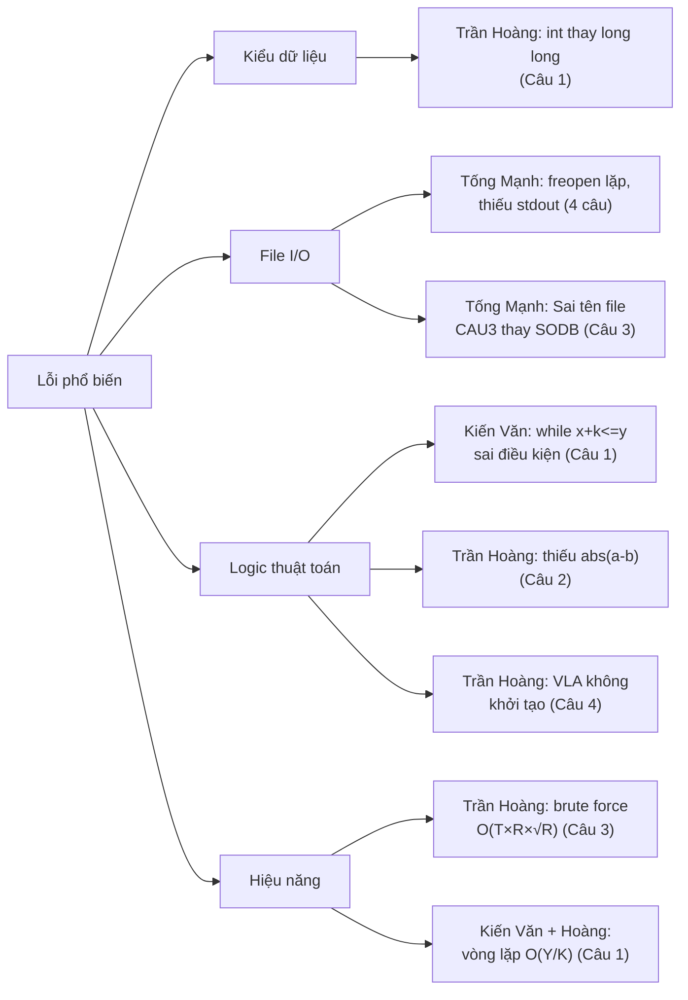

# 📋 BÁO CÁO CHẤM BÀI THI LẬP TRÌNH — CHI TIẾT

> **Đề thi**: 4 câu (Bơm nước · Tam giác · Số đặc biệt · Số cameras)  
> **Thí sinh**: Nguyễn Kiến Văn · Trần Hoàng · Nguyễn Tống Mạnh  
> **Thang điểm**: Mỗi câu **5 điểm**, tổng **20 điểm**

---

## 📝 PHẦN A — TÓM TẮT ĐỀ THI & LỜI GIẢI CHUẨN

---

### Câu 1 — Bơm nước (5đ)

| Mục | Nội dung |
|---|---|
| **Đề bài** | Mức nước hiện tại $X$, mức yêu cầu $Y$, mỗi lần bơm tăng $K$. Tìm số lần bơm **tối thiểu** để đạt hoặc vượt $Y$. |
| **Giới hạn** | $1 \le X, Y \le 10^{12}$; $1 \le K \le 10^4$ |
| **I/O** | `CAU1.INP` → `CAU1.OUT` |
| **Subtask** | 60% tests: $X, Y \le 10^8$, $K \le 10^5$. Còn lại: không ràng buộc thêm. |

**Lời giải chuẩn** — $O(1)$:
$$\text{ans} = \begin{cases} 0 & \text{nếu } X \ge Y \\ \left\lceil \dfrac{Y - X}{K} \right\rceil = \left\lfloor \dfrac{Y - X + K - 1}{K} \right\rfloor & \text{nếu } X < Y \end{cases}$$

---

### Câu 2 — Tam giác (5đ)

| Mục | Nội dung |
|---|---|
| **Đề bài** | Cho hai số nguyên dương $a, b$. Đếm số nguyên dương $c$ sao cho $a, b, c$ là 3 cạnh tam giác. |
| **Giới hạn** | $1 \le a, b \le 10^9$ |
| **I/O** | `CAU2.INP` → `CAU2.OUT` |
| **Subtask** | 70% tests: $a, b \le 10^5$. Còn lại: không ràng buộc thêm. |

**Lời giải chuẩn** — Bất đẳng thức tam giác $|a-b| < c < a+b$:
$$c \in \big[|a-b|+1,\; a+b-1\big] \quad\Longrightarrow\quad \text{ans} = a + b - |a - b| - 1$$

---

### Câu 3 — Số đặc biệt (5đ)

| Mục | Nội dung |
|---|---|
| **Đề bài** | "Số đặc biệt" = số có **đúng 4 ước dương**. Cho $T$ truy vấn $(L, R)$, đếm số đặc biệt trong $[L, R]$. |
| **Giới hạn** | $T \le 10^6$, $L < R \le 10^6$ |
| **I/O** | `SODB.INP` → `SODB.OUT` |
| **Subtask** | 60%: $T \le 10^2, R \le 10^3$. 30%: $T \le 10^3, R \le 10^5$. 10%: $T \le 10^6, R \le 10^6$. |

**Lời giải chuẩn** — Sàng ước $O(N\log N)$ + Prefix Sum:
```
Bước 1: Dùng sàng tính cnt[i] = số ước của i (1 ≤ i ≤ 10^6)
Bước 2: Tạo prefix[i] = số lượng j ≤ i mà cnt[j] == 4
Bước 3: Trả lời mỗi query O(1): prefix[R] - prefix[L-1]
```

---

### Câu 4 — Số cameras (5đ)

| Mục | Nội dung |
|---|---|
| **Đề bài** | $n$ khu vực trên đường thẳng, $q$ camera tại vị trí $c_i$ bán kính $r$. Camera tại $c_i$ phủ $[\max(1, c_i - r),\; \min(n, c_i + r)]$. Đếm số camera phủ mỗi khu vực. |
| **Giới hạn** | $n, q \le 10^5$, $0 \le r < n$ |
| **I/O** | `CAU4.INP` → `CAU4.OUT` |
| **Subtask** | 20%: $r = 0$. 40%: $n, q \le 7000$. 20%: $n \le 7000$. 20%: không ràng buộc. |

**Lời giải chuẩn** — Mảng hiệu (Difference Array) $O(n + q)$:
```
Với mỗi camera tại c_i: diff[max(1, c_i - r)]++, diff[min(n, c_i + r) + 1]--
Sau đó tính prefix sum để ra kết quả.
```

---
---

## 📖 PHẦN B — ĐÁNH GIÁ CHI TIẾT TỪNG HỌC SINH

---

# 👤 HỌC SINH 1: NGUYỄN KIẾN VĂN

---

## ▸ Câu 1 — Bơm nước

**Code nộp:**
```cpp
freopen("CAU1.INP", "r", stdin);
freopen("CAU1.OUT", "w", stdout);
long long x, y; cin >> x >> y;
long long k;    cin >> k;
long long solan = 0;
while (x + k <= y) {
    x += k;
    solan++;
}
cout << solan << endl;
```

#### ✅ Điểm đúng:
- **File I/O**: `CAU1.INP` / `CAU1.OUT` → ✅ Chính xác
- **Kiểu dữ liệu**: `long long` cho $X, Y$ → ✅ An toàn với $10^{12}$

#### ❌ Điểm sai:

**Lỗi 1 — Sai logic vòng lặp (nghiêm trọng):**
Điều kiện `while (x + k <= y)` chỉ bơm khi bước tiếp theo **vẫn ≤ Y**. Khi $Y - X$ **không chia hết** cho $K$, bỏ sót lần bơm cuối cùng.

| Test | Đáp án đúng | Code trả về | Kết quả |
|:---:|:---:|:---:|:---:|
| $(20, 35, 5)$ | 3 | 3 | ✅ $(35-20)/5 = 3$ chia hết |
| $(20, 33, 5)$ | 3 | **2** | ❌ Dừng ở $x=30$, vì $30+5=35 > 33$ |
| $(1, 100, 7)$ | 15 | **14** | ❌ Dừng ở $x=99$, vì $99+7=106 > 100$ |
| $(5, 6, 3)$ | 1 | **0** | ❌ $5+3=8 > 6$, không bơm lần nào |
| $(1, 1, 1)$ | 0 | 0 | ✅ Đã đạt yêu cầu |

**Lỗi 2 — Hiệu năng (TLE tiềm ẩn):**
Vòng lặp chạy $\lfloor(Y-X)/K\rfloor$ lần. Với subtask 40% ($X, Y \le 10^{12}$, $K = 1$): tối đa $10^{12}$ vòng → **TLE chắc chắn**. Nên dùng công thức toán $O(1)$ thay vì vòng lặp.

#### 📊 Ước tính điểm theo subtask:

| Subtask | Trọng số | Phân tích | Ước tính đạt |
|---|:---:|---|:---:|
| 60% ($X,Y \le 10^8$) | 3đ | Không TLE, nhưng sai khi $(Y-X) \% K \ne 0$ → đúng ~30% tests | ~1đ |
| 40% ($X,Y \le 10^{12}$) | 2đ | TLE (vòng lặp tới $10^{12}$) | 0đ |

#### **→ Điểm Câu 1: 1/5**

#### 💡 Cần cải thiện:
Thay vòng lặp bằng công thức `ceil((Y-X)/K)` = `(Y - X + K - 1) / K`. Vừa đúng, vừa $O(1)$.

---

## ▸ Câu 2 — Tam giác

**Code nộp:**
```cpp
long long a, b;
cin >> a >> b;
cout << a + b - abs(a - b) - 1;
```

#### ✅ Điểm đúng:
- **File I/O**: ✅ Chính xác
- **Kiểu dữ liệu**: `long long` → ✅ An toàn
- **Logic thuật toán**: ✅ **ĐÚNG HOÀN TOÀN** — Công thức chuẩn $a + b - |a - b| - 1$

#### Kiểm chứng:

| Test | Đáp án | Code | Kết quả |
|:---:|:---:|:---:|:---:|
| $(2, 2)$ | 3 | 3 | ✅ |
| $(1, 5)$ | 1 | 1 | ✅ |
| $(3, 7)$ | 5 | 5 | ✅ |
| $(100, 1)$ | 1 | 1 | ✅ |

#### **→ Điểm Câu 2: 5/5**

---

## ▸ Câu 3 — Số đặc biệt

**Code nộp:**
```cpp
// Sàng đếm ước
for (int i = 1; i <= Max; i++)
    for (int j = i; j <= Max; j += i)
        uoc[j]++;

// Prefix sum
for (int i = 1; i <= Max; i++) {
    dem[i] = dem[i - 1];
    if (uoc[i] == 4) dem[i]++;
}

// Trả lời mỗi query O(1)
cout << dem[R] - dem[L - 1] << '\n';
```

#### ✅ Điểm đúng:
- **File I/O**: `SODB.INP` / `SODB.OUT` → ✅ Chính xác
- **Thuật toán**: Sàng ước $O(N\log N)$ + Prefix Sum → ✅ **Tối ưu**
- **Logic**: ✅ **ĐÚNG HOÀN TOÀN** — Mỗi query trả lời $O(1)$
- **Mảng toàn cục**: `int uoc[Max+1]`, `int dem[Max+1]` → ✅ Tự khởi tạo = 0

#### **→ Điểm Câu 3: 5/5** — Bài làm mẫu mực

---

## ▸ Câu 4 — Số cameras

**Code nộp:**
```cpp
int a[Max]; // Mảng toàn cục, khởi tạo = 0
// ...
int x = max(1, c - r);
int y = min(n, c + r);
a[x]++;
a[y + 1]--;
// Prefix sum
for (int i = 1; i <= n; i++) {
    a[i] += a[i - 1];
    cout << a[i] << " ";
}
```

#### ✅ Điểm đúng:
- **File I/O**: ✅ Chính xác
- **Thuật toán**: Mảng hiệu (Difference Array) → ✅ **Tối ưu $O(n + q)$**
- **Xử lý biên**: `max(1, c-r)` và `min(n, c+r)` → ✅ Chính xác
- **Khởi tạo mảng**: Mảng toàn cục `a[Max]` → ✅ Tự động = 0

#### **→ Điểm Câu 4: 5/5** — Áp dụng hoàn hảo kỹ thuật mảng hiệu

---

### 🏆 TỔNG KẾT NGUYỄN KIẾN VĂN

| Câu | Điểm | Chi tiết |
|:---:|:---:|---|
| Câu 1 | **1/5** | ❌ Sai logic vòng lặp + TLE subtask lớn |
| Câu 2 | **5/5** | ✅ Hoàn hảo |
| Câu 3 | **5/5** | ✅ Hoàn hảo — Sàng + Prefix Sum |
| Câu 4 | **5/5** | ✅ Hoàn hảo — Difference Array |
| **TỔNG** | **16/20** | |

> **Nhận xét**: Kiến Văn có nền tảng thuật toán **rất vững** — thành thạo sàng ước, prefix sum, difference array (3 câu cuối hoàn hảo). Câu 1 mắc lỗi đáng tiếc ở điều kiện vòng lặp: dùng `while (x + k <= y)` thay vì cần `while (x < y)`, đồng thời nên ưu tiên **công thức toán $O(1)$** thay vì vòng lặp mô phỏng để vừa chính xác vừa tránh TLE.

---
---

# 👤 HỌC SINH 2: TRẦN HOÀNG

---

## ▸ Câu 1 — Bơm nước

**Code nộp:**
```cpp
int x, y, k;   // ⚠️ int!
freopen("CAU1.inp", "r", stdin);
freopen("CAU1.out", "w", stdout);
cin >> x >> y; cin >> k;
int tangthem = 0;
int kq = 0;
while(tangthem < y){
    tangthem = x + k;
    x = tangthem;
    kq += 1;
    if(tangthem == y || tangthem > y) break;
}
cout << kq << endl;
```

#### ✅ Điểm đúng:
- **File I/O**: ✅ `CAU1.inp` / `CAU1.out` — Đúng
- **Logic mô phỏng**: ✅ Đúng cho trường hợp $X < Y$ — vòng lặp bơm đến khi $\ge Y$ rồi dừng

#### ❌ Điểm sai:

**Lỗi 1 — Kiểu dữ liệu `int` (nghiêm trọng):**
$X, Y \le 10^{12}$ nhưng dùng `int` (tối đa $\approx 2.1 \times 10^9$) → **tràn số** trên toàn bộ subtask 40%.

**Lỗi 2 — Sai khi $X \ge Y$:**
Biến `tangthem` khởi tạo = 0, nên `while(0 < y)` **luôn đúng** dù $X$ đã $\ge Y$ → bơm thừa 1 lần.

| Test | Đáp án | Code | Kết quả |
|:---:|:---:|:---:|:---:|
| $(20, 35, 5)$ | 3 | 3 | ✅ |
| $(20, 33, 5)$ | 3 | 3 | ✅ |
| $(5, 6, 3)$ | 1 | 1 | ✅ |
| $(1, 1, 1)$ | 0 | **1** | ❌ $X \ge Y$, bơm thừa |
| $(100, 50, 5)$ | 0 | **1** | ❌ Tương tự |

**Lỗi 3 — TLE tiềm ẩn:**
Tương tự Kiến Văn, vòng lặp chạy đến $10^{12}$ lần cho subtask lớn.

#### 📊 Ước tính điểm:

| Subtask | Trọng số | Phân tích | Ước tính |
|---|:---:|---|:---:|
| 60% ($X,Y \le 10^8$) | 3đ | `int` không tràn, logic đúng cho $X < Y$, có thể sai edge case $X \ge Y$ | ~2đ |
| 40% ($X,Y \le 10^{12}$) | 2đ | `int` tràn → toàn bộ sai | 0đ |

#### **→ Điểm Câu 1: 2/5**

#### 💡 Cần cải thiện:
1. Dùng `long long` thay `int` khi giới hạn > $2 \times 10^9$
2. Kiểm tra $X \ge Y$ trước khi vào vòng lặp
3. Nên dùng công thức toán $O(1)$

---

## ▸ Câu 2 — Tam giác

**Code nộp:**
```cpp
int a, b;
cin >> a >> b;
cout << (a + b) - 1;
```

#### ❌ Điểm sai:

**Lỗi logic (nghiêm trọng) — Thiếu $|a - b|$:**
Công thức đúng là $a + b - |a-b| - 1$, nhưng code chỉ tính $(a + b) - 1$. Thiếu hoàn toàn phần trừ $|a - b|$.

| Test | Đáp án | Code | Kết quả |
|:---:|:---:|:---:|:---:|
| $(2, 2)$ | 3 | 3 | ✅ Chỉ đúng khi $a = b$ ($|a-b| = 0$) |
| $(1, 5)$ | 1 | **5** | ❌ Sai gấp 5 lần |
| $(3, 7)$ | 5 | **9** | ❌ |
| $(100, 1)$ | 1 | **100** | ❌ Sai rất xa |
| $(1, 1)$ | 1 | 1 | ✅ |

> [!CAUTION]
> Công thức $(a+b)-1$ cho phép cả các giá trị $c \le |a-b|$ — chúng **không** tạo thành tam giác. Ví dụ: $a=1, b=5$, $c$ phải $> 4$, tức chỉ có $c = 5$ duy nhất. Code đếm $c \in \{1,2,3,4,5\}$ → thừa 4 giá trị.

#### **→ Điểm Câu 2: 0.5/5** — Chỉ đúng trường hợp $a = b$

#### 💡 Cần cải thiện:
Nắm kỹ bất đẳng thức tam giác: **cả 3 cặp** phải thỏa. Điều kiện $c > |a-b|$ là thiết yếu.

---

## ▸ Câu 3 — Số đặc biệt

**Code nộp:**
```cpp
bool lsdb(long long n){
    int dem = 0;
    for(long long i = 1; i*i <= n; i++){
        if(n % i == 0){
            dem++;
            if(i * i != n) dem++;
        }
        if(dem > 4) return false;  // Cắt sớm
    }
    return dem == 4;
}
// ...
for(long long x = L; x <= R; x++){
    if(lsdb(x)) demSDB++;
}
```

#### ✅ Điểm đúng:
- **File I/O**: `SODB.inp` / `SODB.out` → ✅ Đúng
- **Hàm kiểm tra `lsdb()`**: ✅ Đếm ước bằng $\sqrt{n}$, cắt sớm khi $> 4$ — **logic hoàn toàn đúng**

#### ❌ Điểm sai:

**Lỗi hiệu năng — Brute force quá chậm:**

| Subtask | Trọng số | Ước tính thời gian | Kết quả |
|---|:---:|---|:---:|
| 60% ($T \le 10^2, R \le 10^3$) | 3đ | $10^2 \times 10^3 \times 32 \approx 3 \times 10^6$ | ✅ AC |
| 30% ($T \le 10^3, R \le 10^5$) | 1.5đ | $10^3 \times 10^5 \times 316 \approx 3 \times 10^{10}$ | ❌ TLE |
| 10% ($T \le 10^6, R \le 10^6$) | 0.5đ | $10^6 \times 10^6 \times 10^3 \approx 10^{15}$ | ❌ TLE |

#### **→ Điểm Câu 3: 3/5** — Logic đúng, đạt 60% subtask

#### 💡 Cần cải thiện:
Học kỹ thuật **sàng ước + prefix sum** để tiền xử lý $O(N\log N)$, trả lời mỗi query $O(1)$.

---

## ▸ Câu 4 — Số cameras

**Code nộp:**
```cpp
int diff[n + 2];    // ⚠️ VLA — KHÔNG khởi tạo!
for(int i = 1; i <= q; i++){
    int c; cin >> c;
    int L = max(1, c - r);
    int R = min(n, c + r);
    diff[L] += 1;
    diff[R + 1] -= 1;
}
int camerahientai = 0;
for(int i = 1; i <= n; i++){
    camerahientai += diff[i];
    cout << camerahientai << (i == n ? "" : " ");
}
```

#### ✅ Điểm đúng:
- **File I/O**: ✅ Đúng
- **Thuật toán**: ✅ Mảng hiệu — ý tưởng hoàn toàn đúng
- **Xử lý biên**: ✅ `max(1, c-r)` và `min(n, c+r)` — chính xác

#### ❌ Điểm sai:

**Lỗi nghiêm trọng — Mảng VLA không khởi tạo:**
```cpp
int diff[n + 2];  // Variable Length Array — giá trị ban đầu là RÁC (garbage)!
```
VLA (Variable Length Array) trên stack **KHÔNG** được tự động gán = 0 như mảng toàn cục. Giá trị ban đầu của `diff[]` là rác ngẫu nhiên → **toàn bộ kết quả bị sai**.

**Cách sửa** (chọn 1 trong 3):
```cpp
int diff[n + 2] = {};              // Brace-initialization → tất cả = 0
memset(diff, 0, sizeof(diff));     // Gán 0 thủ công
vector<int> diff(n + 2, 0);       // Dùng vector thay VLA
```

#### **→ Điểm Câu 4: 1/5** — Ý tưởng đúng nhưng kết quả sai do lỗi kỹ thuật

---

### 🏆 TỔNG KẾT TRẦN HOÀNG

| Câu | Điểm | Chi tiết |
|:---:|:---:|---|
| Câu 1 | **2/5** | ⚠️ Tràn `int` + sai khi $X \ge Y$ |
| Câu 2 | **0.5/5** | ❌ Công thức sai — thiếu $|a-b|$ |
| Câu 3 | **3/5** | ✅ Logic đúng nhưng brute force → TLE subtask lớn |
| Câu 4 | **1/5** | ❌ Mảng VLA không khởi tạo → kết quả rác |
| **TỔNG** | **6.5/20** | |

> **Nhận xét**: Trần Hoàng cho thấy đã biết một số kỹ thuật hay (difference array, đếm ước bằng $\sqrt{n}$), nhưng mắc **rất nhiều lỗi kỹ thuật cơ bản** khiến bài đúng ý tưởng mà sai kết quả:
> 1. **Kiểu dữ liệu**: Không kiểm tra giới hạn đề bài → dùng `int` khi cần `long long`
> 2. **Khởi tạo mảng**: VLA trên stack không tự gán 0 — đây là kiến thức C++ nền tảng cần nắm vững
> 3. **Toán học**: Thiếu phân tích bất đẳng thức tam giác → công thức Câu 2 sai
> 4. **Tối ưu thuật toán**: Cần học sàng + prefix sum để thay thế brute force ở Câu 3

---
---

# 👤 HỌC SINH 3: NGUYỄN TỐNG MẠNH

---

> [!CAUTION]
> ### ⛔ LỖI CHUNG CỰC KỲ NGHIÊM TRỌNG — ẢNH HƯỞNG TẤT CẢ 4 CÂU
> 
> **Tất cả 4 file code** đều mắc cùng một lỗi copy-paste:
> ```cpp
> // Dòng đúng:
> freopen("CAUx.inp", "r", stdin);
> freopen("CAUx.out", "w", stdout);  // ← CẦN DÒNG NÀY
> 
> // Nhưng code thực tế:
> freopen("CAUx.inp", "r", stdin);
> freopen("CAUx.inp", "r", stdin);  // ← LẶP LẠI DÒNG TRÊN! THIẾU OUT!
> ```
> 
> **Hậu quả**: Kết quả **chỉ in ra console** (màn hình), **KHÔNG ghi vào file `.OUT`**. Hệ thống chấm tự động đọc file `.OUT` → **file trống** → **0 điểm tất cả các câu**.
> 
> Đây là lỗi **copy-paste** cực kỳ đáng tiếc: dòng thứ 2 lẽ ra phải là `freopen("...", "w", stdout)` nhưng bị dán nhầm thành dòng input.

Dưới đây tôi vẫn phân tích **logic thuật toán** từng câu để đánh giá năng lực thực sự của học sinh.

---

## ▸ Câu 1 — Bơm nước

**Code nộp:**
```cpp
long long a, b, c;
cin >> a >> b >> c;
cout << (b - a + c - 1) / c;
```

#### Đánh giá logic (nếu file I/O đúng):
- **Kiểu dữ liệu**: ✅ `long long` — An toàn
- **Công thức**: ✅ $\lceil(Y-X)/K\rceil = \lfloor(Y-X+K-1)/K\rfloor$ — **ĐÚNG**
- **Hiệu năng**: ✅ $O(1)$ — Tối ưu tuyệt đối
- **Edge case $X \ge Y$**: ⚠️ Khi $Y < X$, biểu thức $(Y-X+K-1)/K$ cho giá trị âm (C++ trả về giá trị âm do truncation toward zero). Nếu test có $X \ge Y$, kết quả sai.

| Test | Đáp án | Logic Code | Kết quả |
|:---:|:---:|:---:|:---:|
| $(20, 35, 5)$ | 3 | $(35-20+4)/5 = 3$ | ✅ |
| $(20, 33, 5)$ | 3 | $(33-20+4)/5 = 3$ | ✅ |
| $(5, 6, 3)$ | 1 | $(6-5+2)/3 = 1$ | ✅ |
| $(1, 1, 1)$ | 0 | $(1-1+0)/1 = 0$ | ✅ |
| $(100, 50, 5)$ | 0 | $(50-100+4)/5 = -9$ | ❌ |

#### **→ Điểm logic: 4.5/5** | **Điểm thực tế: 0/5** (thiếu `freopen` stdout)

---

## ▸ Câu 2 — Tam giác

**Code nộp:**
```cpp
long long a, b;
cin >> a >> b;
long long bd = abs(a - b);
long long en = a + b;
cout << en - bd - 1;
```

#### Đánh giá logic:
- **Kiểu dữ liệu**: ✅ `long long` — An toàn
- **Công thức**: ✅ $a + b - |a - b| - 1$ — **ĐÚNG HOÀN TOÀN**

| Test | Đáp án | Logic Code | Kết quả |
|:---:|:---:|:---:|:---:|
| $(2, 2)$ | 3 | 3 | ✅ |
| $(1, 5)$ | 1 | 1 | ✅ |
| $(3, 7)$ | 5 | 5 | ✅ |
| $(100, 1)$ | 1 | 1 | ✅ |

#### **→ Điểm logic: 5/5** | **Điểm thực tế: 0/5** (thiếu `freopen` stdout)

---

## ▸ Câu 3 — Số đặc biệt

**Code nộp:**
```cpp
freopen("CAU3.inp", "r", stdin);  // ⚠️ SAI TÊN FILE! Đề yêu cầu SODB.INP
freopen("CAU3.inp", "r", stdin);  // Lặp lại + thiếu OUT
// ...
// Logic: Sàng ước + Prefix Sum (giống Kiến Văn)
```

#### Đánh giá logic:
- **Thuật toán**: ✅ Sàng ước + Prefix Sum — **Tối ưu**
- **Logic**: ✅ **ĐÚNG HOÀN TOÀN**
- **Tên file I/O**: ❌ Dùng `CAU3.inp` thay vì `SODB.INP` — sai tên file input (lỗi đọc đề)

#### **→ Điểm logic: 5/5** | **Điểm thực tế: 0/5** (sai tên file + thiếu `freopen` stdout)

---

## ▸ Câu 4 — Số cameras

**Code nộp:**
```cpp
vector<int> pre(n + 5, 0);
for(int i = 1; i <= q; i++){
    long long x; cin >> x;
    pre[max(1LL, x - r)] += 1;
    pre[x + r + 1] -= 1;       // ⚠️ Thiếu min(n, x+r)!
}
for(int i = 1; i <= n; i++)
    pre[i] = pre[i-1] + pre[i];
```

#### Đánh giá logic:
- **Thuật toán**: ✅ Mảng hiệu — đúng ý tưởng
- **Khởi tạo**: ✅ `vector<int> pre(n+5, 0)` — đúng (khác với Trần Hoàng)
- **Xử lý biên trái**: ✅ `max(1LL, x-r)` — chính xác
- **Xử lý biên phải**: ❌ **THIẾU `min(n, x+r)`**

> [!WARNING]
> **Lỗi truy cập ngoài mảng (Out of Bounds):**
> 
> `pre[x + r + 1] -= 1` mà không kiểm tra `x + r + 1 ≤ n + 4` (kích thước vector).
> 
> Ví dụ: $n = 10^5$, $r = 9.9 \times 10^4$, $x = 10^5$ → $x + r + 1 = 2 \times 10^5 + 1$ nhưng vector chỉ có $10^5 + 5$ phần tử → **crash hoặc Undefined Behavior**.

#### **→ Điểm logic: 3.5/5** | **Điểm thực tế: 0/5** (thiếu `freopen` stdout + lỗi biên)

---

### 🏆 TỔNG KẾT NGUYỄN TỐNG MẠNH

| Câu | Điểm Logic | Điểm Thực Tế | Chi tiết |
|:---:|:---:|:---:|---|
| Câu 1 | 4.5/5 | **0/5** | ✅ Công thức $O(1)$ đúng | ❌ Thiếu `freopen` stdout |
| Câu 2 | 5/5 | **0/5** | ✅ Logic hoàn hảo | ❌ Thiếu `freopen` stdout |
| Câu 3 | 5/5 | **0/5** | ✅ Sàng + prefix sum | ❌ Sai tên file + thiếu stdout |
| Câu 4 | 3.5/5 | **0/5** | ⚠️ Thiếu check biên phải | ❌ Thiếu `freopen` stdout |
| **Logic** | **18/20** | | |
| **TỔNG** | | **0/20** | |

> **Nhận xét**: Nghịch lý đáng tiếc nhất — Tống Mạnh có tư duy thuật toán **giỏi nhất trong 3 học sinh**: dùng công thức $O(1)$ cho Câu 1 (hai bạn kia dùng vòng lặp), sàng + prefix sum cho Câu 3, difference array cho Câu 4. Logic đúng 18/20 điểm. Tuy nhiên, lỗi copy-paste `freopen` ở **tất cả 4 câu** khiến toàn bộ output không được ghi ra file → **0 điểm trên hệ thống chấm**.
> 
> **Bài học rút ra**:
> 1. **Tạo template code** có sẵn `freopen` đúng chuẩn, không phải gõ lại mỗi bài
> 2. **Luôn chạy thử bằng file**: Kiểm tra xem file `.OUT` có được tạo ra không trước khi nộp
> 3. **Review code trước khi nộp**: Đọc lại phần `freopen` — chỉ mất 5 giây nhưng cứu 20 điểm

---
---

## 📊 PHẦN C — BẢNG TỔNG KẾT TOÀN BỘ

### Bảng điểm chính thức

| | Câu 1 (5đ) | Câu 2 (5đ) | Câu 3 (5đ) | Câu 4 (5đ) | **TỔNG** |
|:---|:---:|:---:|:---:|:---:|:---:|
| 🥇 **Nguyễn Kiến Văn** | 1 | 5 | 5 | 5 | **16/20** |
| 🥈 **Trần Hoàng** | 2 | 0.5 | 3 | 1 | **6.5/20** |
| 🥉 **Nguyễn Tống Mạnh** | 0 | 0 | 0 | 0 | **0/20** |

### Bảng điểm logic (nếu chỉ chấm thuật toán)

| | Câu 1 | Câu 2 | Câu 3 | Câu 4 | **TỔNG** |
|:---|:---:|:---:|:---:|:---:|:---:|
| **Nguyễn Kiến Văn** | 1 | 5 | 5 | 5 | **16/20** |
| **Trần Hoàng** | 2 | 0.5 | 3 | 1 | **6.5/20** |
| **Nguyễn Tống Mạnh** | 4.5 | 5 | 5 | 3.5 | **18/20** |

---

### 🔬 Phân tích lỗi phổ biến



---

### 📝 Khuyến nghị cải thiện cho từng học sinh

#### Nguyễn Kiến Văn (16/20)
- ✅ Điểm mạnh: Nền tảng thuật toán vững, code sạch
- 🔧 Cải thiện: Ưu tiên **công thức toán** $O(1)$ thay vì vòng lặp mô phỏng khi có thể

#### Trần Hoàng (6.5/20)
- ✅ Điểm mạnh: Biết ý tưởng difference array và đếm ước bằng $\sqrt{n}$
- 🔧 Cải thiện cấp bách:
  1. **Luôn đọc kỹ giới hạn** → Chọn `long long` khi giá trị > $2 \times 10^9$
  2. **Học kỹ khởi tạo mảng** — VLA, mảng toàn cục, `vector` khác nhau thế nào
  3. **Phân tích toán kỹ hơn** trước khi code
  4. **Học sàng + prefix sum** — kỹ thuật nền tảng cho bài đếm

#### Nguyễn Tống Mạnh (0/20, logic 18/20)
- ✅ Điểm mạnh: Tư duy thuật toán **xuất sắc**, code gọn, công thức toán tối ưu
- 🔧 Cải thiện tối khẩn cấp:
  1. **Tạo template code** với `freopen` đúng sẵn
  2. **Chạy thử bằng file** trước khi nộp (kiểm tra file `.OUT` tồn tại)
  3. **Review lại 2 dòng `freopen`** mỗi bài — chỉ mất 5 giây
